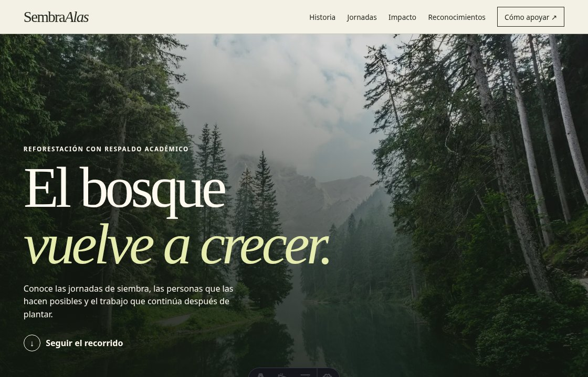
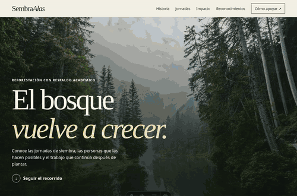

# SembraAlas · Restauración en territorio

Una landing que cuenta el recorrido de SembraAlas, una iniciativa de reforestación con enfoque académico. Desde la portada puedes explorar la historia, las jornadas de siembra, los resultados y las formas de apoyar el cuidado de lo sembrado.


[Vista previa](#vista-previa) · [Inicio local](#inicio-local) · [Canal de donaciones](#canal-de-donaciones)

## Vista previa

<a href="docs/media/portada.jpg"></a>

<details>
<summary>Ver el recorrido en GIF</summary>



</details>

## Qué incluye

- **Historia y jornadas.** Un recorrido visual por el origen del proyecto y el trabajo en territorio.
- **Impacto y reconocimientos.** Indicadores del proyecto y una sección visible con sus distinciones.
- **Cómo apoyar.** Una página dedicada a explicar qué puede hacer posible un aporte.
- **Imágenes ligeras.** Astro genera variantes WebP según el tamaño de pantalla. Las fotos fuera de la portada se cargan a medida que el visitante se acerca.

## Inicio local

```bash
npm ci
npm run dev
```

Abre [localhost:4321](http://localhost:4321/). Para generar el sitio estático en `dist/`, ejecuta `npm run build`.

## Canal de donaciones

Copia `.env.example` a `.env` y define `SEMBRA_DONATION_URL` con el enlace HTTPS oficial si ya está disponible. Reinicia el servidor local o vuelve a compilar el sitio publicado para activar el enlace. Mientras la variable esté vacía, la página explica cómo apoyar y muestra que aún no hay canal publicado.

## Estructura

| Carpeta | Contenido |
| --- | --- |
| `src/pages/` | Portada y página de apoyo |
| `src/content/data/` | Jornadas, cifras, reconocimientos y galería |
| `src/assets/images/` | Imágenes del sitio |
| `src/styles/` | Estilos del recorrido |
| `docs/media/` | Captura y GIF de este README |

Las fotografías editoriales de la portada y la historia se acreditan en el pie del sitio. Los paisajes que acompañan las jornadas son ilustrativos.
